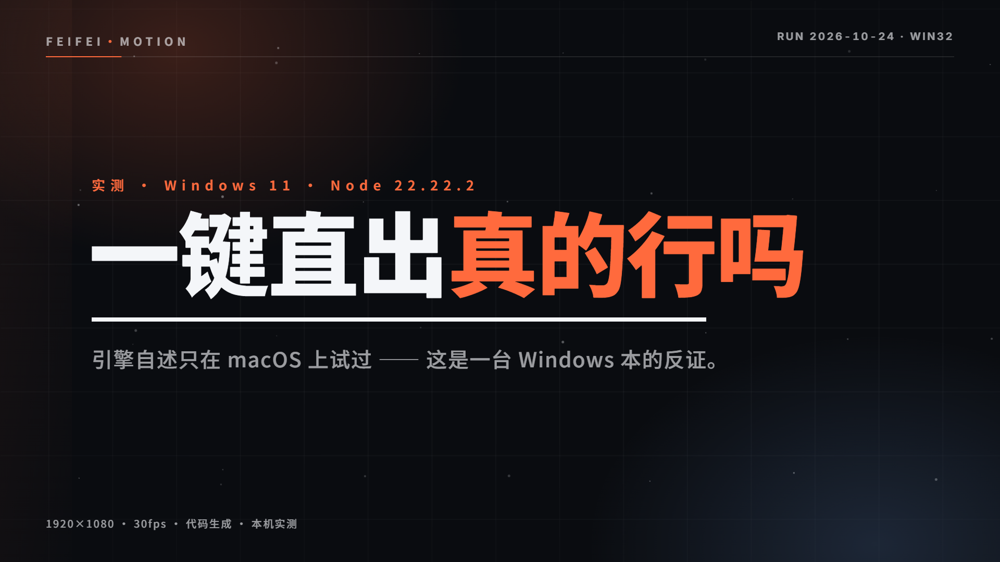

# huashu-motion · Windows 实测与补丁

> 上一次有人问「这个 skill 在 Windows 上能用吗」，答案是「目前只在 macOS 上实测过」。
> 这份仓库就是那个答案的实测版：**28 项能力逐条跑过、3 个跨平台缺陷修了、一支 26.9 秒的片子交付了**。

[](LICENSE)
[]()
[](https://github.com/alchaincyf/huashu-motion)

被测对象：[`alchaincyf/huashu-motion`](https://github.com/alchaincyf/huashu-motion) v0.3.1（MIT），出自微信公众号「花叔」2026-10-18 的发布文。



---

## 结论先说

| 能力 | 在这台 Windows 上 |
|---|---|
| `om doctor` 环境体检 | ✅ 4/4（Node / FFmpeg+ffprobe / 四种编码器 / Chrome） |
| `om grab` 抓产品素材（网页 / 本地工程） | ✅ 含品牌色、字体、内联 SVG logo，缺失项如实上报 |
| `om studio` 编辑器 + 按 C 指着画面改 | ✅ 评论自带时间点与场景名，收件箱闭环走通 |
| `om look` 看用户点的那一帧 | ✅ 存整帧 + 点击处 2x 特写 |
| 作曲模式（ABC 谱 + `om sound`） | ✅ 314 音符 / 5 声部，6 个场景标记全部落点（偏差 ≤0.4%） |
| 23 种音效 / 12 类兜底配乐 | ✅ |
| `om check` 渲染前自检 | ✅ 一次抓出 8 个真问题 |
| `om render` 1080p30 | ✅ 26.9 秒片 35–42 秒渲完 |
| `om qa` 成片自检 | ✅ 第一版被判死（mean 0.15、0 硬切），改到 mean 0.85、10 硬切才过 |
| `om share` / `om export html` / `om fork` | ✅ GIF 8.4MB、分享页 + source.zip、1080×1920 竖屏副本 |
| `om new` / `om fork` / `om demo` | ❌ 原版静默失败 → **本仓库已修** |
| `om samples build`（真乐器包） | ❌ 缺 7-Zip（`.7z` 无 LZMA）→ **已加回退与可执行提示** |
| `om voice`（口播） | ⚠️ 系统音色是 macOS 专属 → **路径与提示已修**；Windows 正解是自带录音 |

完整证据（每条命令的原始输出 + 界面截图 + 成片 + 录屏）：[`TEST-REPORT.md`](TEST-REPORT.md)。

---

## 三行开始

```powershell
git clone https://github.com/alchaincyf/huashu-motion.git ; cd huashu-motion
powershell -File ..\huashu-motion-win32\patches\apply.ps1 -Repo .      # 打补丁
node cli/om.js doctor                                                  # 应该 4 个 ✓
```

然后照上游的流程走：`om grab` → `om new` → `om studio` → `om inbox --wait` → `om check` → `om render` → `om qa`。

验收别靠眼睛扫输出：

```powershell
python scripts\qc_gate.py . my-film --render
# GATE 1 doctor  →  GATE 2 check  →  GATE 3 qa  →  PASS cuts=10 mean motion=0.85/s
```

---

## 里面有什么

```
patches/
  0001-windows.patch     5 个文件 / 178 行：fs.cpSync 崩溃、7z 解压、TTS 路径
  apply.ps1              打补丁（先备份成 .orig）
scripts/
  qc_gate.py             三道验收门（doctor → check → qa），不合格就拦住不让渲染
  score_build.py         按小节数生成 ABC 谱，杜绝 om sound 的"速度弯折"
  sync_score.py          把 .abc 同步进 index.html 的 <script id="om-score">
  splice_script.py       把动画脚本同步进 index.html（v5 迭代 5 次全靠它）
  drive_studio.mjs       用 CDP 驱动 studio 走完"按 C → 点画面 → 写评论 → 发送"
skill/huashu-motion-win32/SKILL.md   操作手册（装成 agent skill 直接可用）
evidence/
  logs/                  每条命令的原始输出（28 份）
  screenshots/           studio 界面、关键帧、色板对照
  films/                 成片 mp4 / gif、studio 操作录屏
```

---

## 三个补丁在修什么

1. **`fs.cpSync(…, {recursive:true})` 在 Windows + Node 22 上直接打死进程**（stdout/stderr 全空，退出码 127），而单文件 `cpSync` 正常——所以 `om new` 复制到一半就没了，CLI 还报 `created`，项目只有 `index.html` 却被当成成功。改成手写 `mkdir + copyFile` 遍历（`cli/lib/fsx.js`）。
2. **`.7z` 解不开**：代码只调 `bsdtar`（Windows 上没这个名字，有等价的 `tar.exe`，但那个 libarchive 没有 LZMA）。改成 `7z → 7za → 7-Zip 安装路径 → bsdtar → tar`，并在失败时说清"装个 7-Zip 再跑一次"。
3. **口播在 Windows 上是死路**：Kokoro 的 venv 路径是 `bin/python`（Windows 是 `Scripts\python.exe`），打印的安装命令是 POSIX 的。按平台拼路径与命令，并明确 `--asr off` 可以完全不用 ASR。

---

## 为什么值得看

- 上游 README 写的是「目前只在 macOS 上实测过」。这份仓库把那句话变成了可执行的替代路径，而不是一句"应该也行"。
- `om qa` 的输出是这次最有用的一课：**它把我的第一版判成了幻灯片**（0 硬切、每秒运动 0.15）。改法也记在报告里（相机推 + 光扫 + 浮尘 + 六处硬切）。
- 作曲模式有个没写进文档的坑：**4/4 的一小节在解析器里是 4 个单位**，小节数错了 `om sound` 不会报错，只会把那段速度弯 25%–50%。`scripts/score_build.py` 就是为此写的。

---

MIT · 补丁与脚本随意用。huashu-motion 本体版权归 [花叔 Huashu](https://github.com/alchaincyf)。
