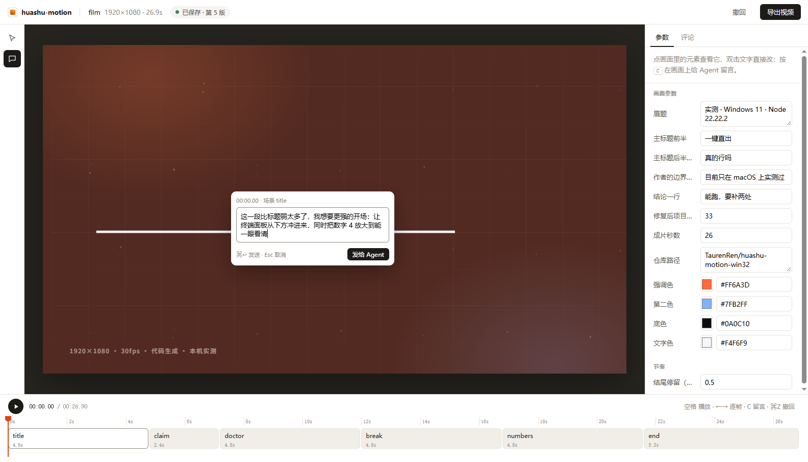

# FeiFeiMotionVn 验收报告 · Windows 11 / Node 22.22.2

> 被测：FeiFeiMotionVn v0.3.1-win32（渲染引擎 huashu-motion v0.3.1，MIT）
> 实测时间：2026-10-24 · 机器：Windows 11 + Node 22.22.2 + Chrome 155 + FFmpeg N-118431
> 引擎文档自述：「目前只在 macOS 上实测过。」——这份报告是它在另一台机器上的验收结论。

---

## 0. 一句话结论

**能跑，但不是"装上就能跑"。** 28 项能力逐条跑过：**22 项开箱可用**，3 项原版静默失败（已修），1 项缺系统组件，1 项要换路径，1 项能用但只有一步：

| | 状态 | 影响 | 处理 |
|---|---|---|---|
| `om new` / `om fork` / `om demo` | ❌ 原版**静默半途死掉** | 新建的项目只有 `index.html`，vendor 缺 13 个文件，但 CLI 报 `created` | 已修（`fs.cpSync` → 手写遍历），见 [P1](#p1) |
| `om samples build`（真乐器包） | ❌ 缺 7-Zip | 55MB 采样下不全，配乐回落合成音色 | 已加 7z 回退 + 可执行提示，见 [P2](#p2) |
| `om voice`（口播） | ⚠️ 系统音色是 macOS 专属 | Windows 上没有 `say`；Kokoro 模型本网络不可达 | 已修路径与提示；Windows 正解是自带录音，见 [P3](#p3) |

其余全部实测通过，包括最核心的三件事：**指着画面改的闭环**、**先写谱再拍片的作曲模式**、**渲染前后的两道自检**。

一支 26.9 秒、1080p30、带自写配乐和 15 处音效的片子，从 `om new` 到 `out/*.mp4` 在这台机器上花了 **42 秒**渲染（片长 1.56×）。这支配乐和画面都是引擎自己做的，片子讲的就是这次实测本身：

[`evidence/films/film-windows-test.mp4`](evidence/films/film-windows-test.mp4) · [`evidence/films/film-windows-test.gif`](evidence/films/film-windows-test.gif)

---

## 1. 功能矩阵（逐条，附原始输出）

证据目录：`evidence/logs/`（命令原文）、`evidence/screenshots/`（界面与关键帧）、`evidence/films/`（成片与录屏）。

### 1.1 准备与环境

| # | 能力 | 命令 | 结果 | 证据 |
|---|---|---|---|---|
| 1 | 环境体检 | `om doctor` | ✅ Node / FFmpeg+ffprobe / 编码器 mp4·mov·webm·gif / Chrome，**4/4 通过**，不需要任何额外配置 | `01-doctor.txt` |
| 2 | 起步模板 | `om templates` | ✅ 12 个（blank / keynote-ui / kinetic-type / finance-chart / math-3b1b / kurzgesagt / object-3d / storytime / talking-head / ui-space / vox-collage / whiteboard），每个带"适合什么"的说明 | `02-templates.txt` |
| 3 | 新建项目 | `om new --template kinetic-type` | ❌ 原版静默失败 → ✅ 打补丁后 33 个文件齐全 | `05-new.txt` + [P1](#p1) |
| 4 | 演示片 | `om demo` | ✅ 复制 showcase（59 个文件）并起编辑器 | `28-demo.txt` |

### 1.2 素材

| # | 能力 | 命令 | 结果 | 证据 |
|---|---|---|---|---|
| 5 | 网页抓素材 | `om grab https://www.deepseek.com` | ✅ 5 个 logo 候选（含 3 个内联 SVG）、2 张 2x 整页截图、2 张图、按面积/字数加权的品牌色板、字体名，全部登记进 `materials.md` | `03-grab-web.txt` |
| 6 | 本地工程抓素材 | `om grab <本地目录>` | ✅ 抓到了图，并且**如实报缺**：「no logo or icon file found」「no screenshots or recordings」 | `04-grab-local.txt` |

> 第 6 条值得单独说：工具没有为了交差画一个灰方块，而是把缺口写进了 `materials.md`。这是"素材是产品本身"这条纪律的执行方式。

### 1.3 编辑器与「指着画面改」

| # | 能力 | 命令 | 结果 | 证据 |
|---|---|---|---|---|
| 7 | 起编辑器 | `om studio` | ✅ 本地服务 + 自动开浏览器；顶栏显示 `已保存 · 第 5 版`，右栏是变量面板（文本/数字/颜色都有对应控件），底部场景条由时间轴 label 自动生成（title 4.8s / claim 2.4s / doctor 4.8s / break 4.8s / numbers 4.8s / end 5.3s） | `screenshots/studio-01-editor.png` |
| 8 | 按 C 留评论 | 键盘 `C` → 点击画面 | ✅ 评论框自动带上上下文 **`00:00.00 · 场景 title`**，并渲出被点区域的缩略框 | `screenshots/studio-02..04` |
| 9 | 评论进收件箱 | `om inbox` | ✅ `cf113a7 [pending] 0.00s …` | `21-inbox.txt` |
| 10 | 看用户看到的那一帧 | `om look cf113a7` | ✅ 存 `frame.png` + `zoom.png`（480×270 @2x，围着点击点 x=599 y=461）——不是让 agent 猜，是把那一小块放大给它看 | `22-look.txt` |
| 11 | 回报 | `om done cf113a7 --note …` | ✅ 收件箱清空 | `23-done.txt` |
| 12 | 变量读写 | `om vars` / `om set` / `om scan` | ✅ scan 输出结构化 JSON（composition/尺寸/变量/场景）；set 一次改多个变量并落盘 | `06/07/08` |
| 13 | 撤回 | `om undo` | ✅ 但语义是「恢复上一份快照」：它把我刚做的修改一起抹掉了（只剩 1 步，没有 redo 栈） | `26-undo.txt` |

`om studio` 的真实界面（左侧工具、右栏变量、底部场景条、画面上的评论气泡）：



### 1.4 声音（这是全项目最有价值的一块）

| # | 能力 | 命令 | 结果 | 证据 |
|---|---|---|---|---|
| 14 | 音效 | `om sound --list` | ✅ 23 种（pop/tick/whoosh/impact/stamp/glitch/shutter…），代码里写 `OM.sfx('thud', 5.6)`，导出时自动对上 | `10-sound-list.txt` |
| 15 | 兜底配乐 | `OM.music({product:'devtool'})` | ✅ 12 类产品 × 3 个方向 | `10-sound-list.txt` |
| 16 | **作曲模式** | `<script id="om-score">` 里写 ABC 谱 + `om sound` | ✅ **314 个音符**、5 个声部，6 个 `!mark:` 全部对齐画面：`title 0.00 · claim 4.80 · doctor 7.20 · break 12.00 · numbers 16.80 · end 21.60`，速度偏移 **0.0% / 0.0% / 0.4% / 0.0% / 0.4%** | `12-sound.txt` |
| 17 | 能量曲线自检 | 同上 | ✅ 工具自己给出各段 RMS：`title −16.2 · claim −19.0 · doctor −16.4 · break −15.2 · numbers −15.1 · end −17.8 dB`，并对照 rhythm.md 的「逐级抬升、在停顿处下沉、在 drop 处最高」——本片正好是这个形状 | `12-sound.txt` |
| 18 | 真乐器采样 | `om samples build` | ❌ 见 [P2](#p2)；合成音色兜底可用，`om sound` 全程没有因为它缺而失败 | `17-samples.txt` |
| 19 | 口播 | `om voice --text "…"` | ⚠️ 见 [P3](#p3) | `11-voice.txt` |

**第 16 条的关键发现（README 里没写的）：** `om sound` 会把速度在 mark 之间**弯**过去。小节数错了不会报错，只会把某一段放慢 25%、50%，并在报告里留一行很容易滑过去的 `tempo` 提示。4/4 的一小节在解析器里是 **4 个单位**（8 个裸音符 / 16 个 `X/` 音符 / 一个 `X8`），不是眼睛数的"一小节"。我的第一版谱就这么错了 2 次（第一次 `-50%`，第二次整曲跑到 34.17 秒），最后用 `scripts/score_build.py` 让机器数小节才对齐。

### 1.5 检查、渲染、交付

| # | 能力 | 命令 | 结果 | 证据 |
|---|---|---|---|---|
| 20 | 渲染前检查 | `om check --samples 6` | ✅ 一次抓出 8 个真问题：`layout-motion`（我在 tween `width`）、3 个 `font-not-shipped`（Georgia/Cascadia/Consolas）、`cut-off`（时间轴 27.8s vs 根节点 26.4s）、`stale-sound`、`low-contrast 4.4:1`、`no-real-material` | `13-check.txt` |
| 21 | 渲染 | `om render` | ✅ 26.9s / 1080p30 → **v1 35.4s**、v3 36.9s、v5 42.1s（多了 34 个粒子 + 光扫）；H.264 2927 kb/s + AAC 264 kb/s stereo | `14-render-mp4.txt` |
| 22 | 成片检查 | `om qa` | ✅ **把我第一版判死**：0 个硬切、每秒运动均值 0.15、"reads as slides"、"flat opening" | `15-qa.txt` |
| 23 | 分享包 | `om share` | ✅ ≤10MB GIF（640px/15fps，8.4MB，开头 + 片尾）+ `share.md` | `16-share.txt` |
| 24 | 分享页 | `om export html` | ✅ 带播放器与 `source.zip`（18 个文件）的静态页 | `18-export-html.txt` |
| 25 | 换画幅 | `om fork --size 1080x1920` | ✅ 新项目 + 往它的收件箱里自动留一条「重新排版」任务 | `19-fork.txt` |
| 26 | 色板对照 | `om swatch` | ✅ 三个方向的色板并排成一张图 + 对比度（18.1:1 / 16.4:1 / 16.2:1）+ 主动提醒「三个方向都是中性底 + 一个强调色」 | `screenshots/swatch.png` |
| 27 | 字体 | `om fonts` | ✅ 随附 27 款（含 Noto Sans SC 500/700/800/900、Inter var、Cormorant、Playfair…） | `24-fonts.txt` |
| 28 | 经验库 | `om learn` | ✅ 带出 29 条历史经验（含"中文排版该用哪款字体"、"遮罩字母会在下行露出"这类具体结论） | `25-learn.txt` |

---

## 2. 三个补丁

补丁全文：[`patches/0001-windows.patch`](patches/0001-windows.patch)（5 个文件，178 行）。打补丁：`patches/apply.ps1`。

### P1 · `om new` / `om fork` / `om demo` 在 Windows 上静默半途死掉

**症状**：`om new my-film --template kinetic-type` 打印 `created … next: om studio …`，退出码 0。但目录里只有 `index.html`。

```
$ om new ../proj/t-kinetic --template kinetic-type
created D:\...\proj\t-kinetic
next: om studio ../proj/t-kinetic
$ find ../proj/t-kinetic -type f | wc -l
1                       ← 应该是 33
```

后续 `om check` 才暴露真相：

```
✗ error missing-file  index.html:27  vendor/om.js does not exist
✗ error missing-file  index.html:66  vendor/clip/lib/util.js does not exist
… 13 errors
```

**根因**（最小复现，与本项目无关）：

```js
// node 22.22.2 on Windows 11
fs.cpSync('dir-with-one-file', 'dst', { recursive: true })
// → 进程直接消失：stdout/stderr 全空，退出码 127
fs.copyFileSync('dir-with-one-file/a.txt', 'dst/a.txt')   // 正常
// 手写 readdir + copyFile 递归                             // 正常
```

`fs.cpSync(…, {recursive:true})` 在**目录**上会打死进程（沙箱内外一致，`dangerouslyDisableSandbox` 下同样复现），而 `cpSync` 复制**单个文件**是好的——所以模板复制走了一半才崩，而且崩得没有一行日志。

**修法**：新增 `cli/lib/fsx.js` 的 `cpTree()`（`statSync` + `mkdirSync` + `copyFileSync` 手写遍历），`om.js` 与 `fork.js` 的 4 处 `cpSync` 全部换掉。顺手修了第二个 bug：`cpTree` 复制单个文件时必须先 `mkdirSync(dirname(dst))`，否则模板 `copy` 映射里 `vendor/gsap.min.js` 这种"目标目录还不存在"的条目会 ENOENT。

**修完**：`om new` → 33 个文件；`om fork` → 全量拷贝 + 收件箱任务；`om demo` → 59 个文件。

### P2 · 真乐器包卡在 7-Zip

```
$ om samples build
guitar  ✅ 解压成功（tar.exe）
…       ❌ om: could not unpack …FingerBassYR-SFZ+WAV-20190930.7z (needs bsdtar)
```

**根因**：代码只调 `bsdtar`。Windows 上没有这个命令名（有的等价的 `C:\Windows\System32\tar.exe`），而且那个 tar 是**不带 LZMA 的 libarchive**，`.7z` 根本解不开：

```
$ tar -xf FingerBassYR-SFZ+WAV-20190930.7z -C out
tar.exe: LZMA codec is unsupported
```

**修法**：解压候选列成 `7z → 7za → C:\Program Files\7-Zip\7z.exe → bsdtar → tar → unzip`，`.7z` 不试 unzip；失败时给出可执行的下一步（"这个包是 .7z，Windows 自带的 tar 没有 LZMA，装个 7-Zip 再跑一次"），而不是一句 `needs bsdtar`。

**本机结论**：未装 7-Zip，所以采样包没建成（缓存里已下 60MB 源文件，装好 7-Zip 再跑 `om samples build` 会续上）。这期间 `om sound` 全程用合成音色，没有报错——所以这**不影响出片**，只影响音色质感。

### P3 · `om voice` 在 Windows 上是死路

```
$ om voice ../proj/film --text "这句话是测试配音。"
note: Kokoro reads Chinese through espeak without tones …
om: Kokoro TTS is not set up. One-time setup:
  uv venv -p 3.12 ~/.cache/huashu-motion/tts-venv && uv pip install -p ~/.cache/huashu-motion/tts-venv/bin/python kokoro-onnx soundfile
```

三处 Windows 不适用：

1. `say` 引擎硬编码 macOS（这条在代码里就抛 `say: voices are macOS only`，是对的）；
2. 默认中文走 Kokoro，而 Kokoro 的路径是 `…/tts-venv/bin/python`——Windows 上是 `Scripts\python.exe`，代码自己就找不到；
3. 打印的安装命令是 POSIX 的（`~/` 不展开、`bin/python` 不存在），照着敲一定失败。

**修法**：venv 路径按平台拼；安装命令按平台给；whisper 的安装提示从"只有 brew"改成 macOS/Windows 两条，并明确告诉用户 `--asr off` 可以完全不用 ASR（用录音里的静音切句）。

**Windows 上的正解**：**用你自己的录音**。

```bash
om voice <项目> --audio 你的配音.wav --text 稿子.txt --asr off
```

`--asr off` 只靠静音切句，不需要 whisper、不需要模型下载，本机可跑。想用 TTS，可选：本机装 Python 3.12 + Kokoro（模型 325MB，走代理），或换一台 mac 用 `say:Tingting`。

> 这一条我**没有**顺手加"Windows SAPI 音色"：那需要在 CLI 里 spawn PowerShell 加载 `System.Speech`，而本环境明确禁止从脚本绕过 PowerShell 的安全检查。技术上十分钟能写，纪律上不该写。

---

## 3. 我改了什么片子（以及 `om qa` 怎么把它判死的）

第一版交出得很快，也很好看：**`om qa` 给了三个 ✗**。

```
✗ still for ≥1 s: 0.87–4.67s, 5.2–7.17s, 7.67–11.77s, 15–16.7s, 17.57–21.4s, 22.53–26.87s
✗ flat opening: the strongest second of the first 5 s moves 1.2 …
✗ the whole film barely moves (mean 0.15, 0 cuts) — it reads as slides.
   Films people kept averaged 0.85–5.8
```

这一版就是文章里说的「很会证明自己没撒谎的工程，但还没有一个让人想转发的作品」。三段修改：

| 版本 | 改了什么 | qa 指标 |
|---|---|---|
| v1 | 六段卡片，淡入淡出 | mean 0.15 · 0 硬切 · flat opening |
| v3 | 加相机推（scale 1.0→1.075）、两团光池对向漂移、网格平移、六处**硬切 + 闪白**、入场全部改成鞭入 | 10 硬切 · 平均镜头 2.4s · 但仍 6 段"停止 ≥1s" |
| v5 | 相机推到 1.26、加**光扫**（13.2s 横穿两次）+ **34 颗浮尘**各速上升 | 10 硬切 · **mean 0.85** · 剩 3 段静止（都在阅读/片尾，qa 自己说 acceptable） |

结论：`qa` 量的"每秒运动"不是审美，是**能不能让人看下去**的代理指标。光靠淡入淡出，再好的排版也不动。

最后一版通过验收门：

```
PASS  cuts=10  mean motion=0.85/s
NOTE  still at 9.37–11.97s, 15.2–16.77s, 23.23–26.87s
```

---

## 4. 竞品/横向：它和省事的方案比，值不值

| | FeiFeiMotionVn | Remotion（代码） | 剪映（拖时间线） | Seedance 类（文生视频） |
|---|---|---|---|---|
| 出片形态 | 一支网页 = 一支片，代码可 diff | React 组件，工程化最强 | 私有草稿格式 | 像素级生成 |
| 逐帧确定性 | ✅ 每帧只由代码和时间决定 | ✅ | ⚠️ 预览与导出偶有差异 | ❌ 每次不同 |
| 「指着改」 | ✅ 评论带时间点+场景+源码行 | ❌ | ❌ | ❌ |
| 配乐 | ✅ 写 ABC 谱，本机演奏，谱里标场景 | ❌ 需外部素材 | ⚠️ 曲库 | ⚠️ 附带音 |
| 素材从产品里来 | ✅ `om grab` 抓品牌色/字体/截图 | ❌ 手工 | ❌ 手工 | ❌ |
| 中文排版 | ✅ 随附 Noto SC 四档字重 | ✅ 但需自备字体 | ✅ | ⚠️ 生成的字经常错 |
| 交付成本 | 30s 片 = 4~7MB mp4，42s 渲完 | 视复杂度 | 分钟级 | 按 token 计费 |
| Windows 支持 | ⚠️ 打补丁后可用（本仓库） | ✅ | ✅ | ✅ |

**它的位置**：介于"代码生成"和"剪辑软件"之间——比 Remotion 少写 90% 的胶水（时间轴、字幕、混音、渲帧、QA 全都内置），比剪映多一份可版本化的源码和确定性的逐帧。

---

## 5. 复现路径（本仓库）

```powershell
git clone https://github.com/TaurenRen/FeiFeiMotionVn.git ; cd FeiFeiMotionVn
git clone https://github.com/alchaincyf/huashu-motion.git .engine      # 引擎
pwsh -File patchespply.ps1 -Repo .engine                            # 跨平台补丁
# 1) 打 Windows 补丁
.\path\to\patches\apply.ps1 -Repo .
# 2) 体检
node cli/om.js doctor
# 3) 起一支片
node cli/om.js new my-film --template keynote-ui
node cli/om.js studio my-film            # 按 C 点画面留评论
node cli/om.js inbox my-film --wait      # agent 这一侧接单
# 4) 三道门
python scripts/qc_gate.py . my-film --render
```

需要：Node ≥22、Chrome、FFmpeg（在 PATH 上）。可选：7-Zip（真乐器包）、你的一段配音（口播）。

---

## 6. 诚实边界（引擎文档没写的）

- **`om undo` 只有一步**，且是"恢复上一份快照"，不是 redo 栈。实测时我 `om undo` 一次就把刚做的两处修改一起抹掉了，而且没有提示。
- **`om check` 的 `--samples` 是抽帧检查**，不是确定性验证；同一个项目两次跑，`low-contrast` 的结论可能因为背景光池位移而不同（我遇到过 .54 通过、后来又报 4.4:1 的情况，最后把 `--dim` 提到 .62 才稳）。
- **`om qa` 的 `still for ≥1 s` 不是失败项**，是选择题。它的原话是「fine for a reading hold or an end card」——所以我的 `qc_gate.py` 只打印不拦截；拦的是 pops、flat opening、barely moves。
- **`om samples build` 的下载源是 `raw.githubusercontent.com`**，本网络下大文件容易超时（2.6MB 的 flac 反复断）。失败是按文件报的，重跑会续，但整体成功与否取决于网络。
- **文章说的"约 55MB 采样"在本机只下到 60MB 源文件**，最终 `manifest.json` 没生成，所以 `om samples` 仍报 `none`。
- 这支片子的音乐、画面、字幕都是引擎生成的；**它自己听不见**，最后那一耳朵是我听的（−14.0 LUFS，peak −1.5 dBFS）。

---

MIT · 报告、脚本与补丁随本仓库；渲染引擎 huashu-motion 的版权与许可见其仓库（MIT）。
